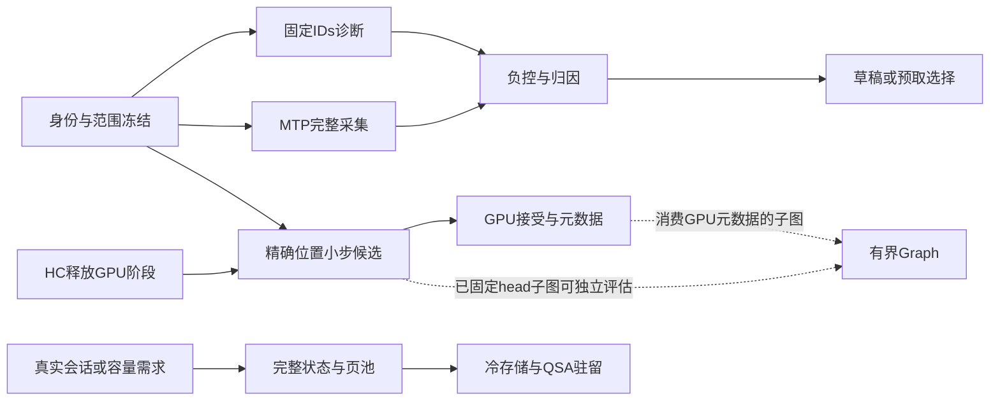

# 外部实现学习与综合实施计划

日期：2026-10-16。状态：计划已制定，实施尚未启动。
依据[四项目源码评估](REFERENCE_REVIEW_2026-10-16.md)与
[Megatron评估](MEGATRON_INFERENCE_REVIEW_2026-10-16.md)，并重新核对本地
生产路径。本轮交付计划，不创建新的活动目标，不启动GPU实验。

**建议主线：补齐可验证的路由诊断和MTP观测，先消除已知冗余同步，
再有条件推进GPU元数据与Graph。完整会话恢复、真实QSA页驻留属于容量
分支；草稿改造单独研究，近似淘汰不进入当前默认计算合同。**

## 1. 起点、约束与新增发现

### 1.1 当前可依赖的基础

| 项目事实 | 本计划的处理 |
|---|---|
| 已接受运行时main `28a3783`，binary `be74946d8159…`；计划起点工作分支`6155270` | 实施前重新绑定当前已接受身份；文档提交不能替代binary身份 |
| Thor SM110a、C++23/CUDA 13.3、统一物理DRAM | 取接口和生命周期设计；不照搬SM120a/SM100专用kernel、TE后端和独显容量假设 |
| 默认单流MTP k3，生产入口`MtpSpeculativeStepMulti → ModelVerifyMulti` | 以此为首次实现范围；旧single API仅作对照，不能代替生产接入验证 |
| N=4近tie、独立accepted-prefix、PLE上传所有权已验收 | 复用身份未变的证据；不重开全模型batch-invariant改造，不放宽门槛 |
| v1完整路由采集、CRC/身份校验、cache/offload回放、留出分析已存在 | 扩展现有工具与格式，避免平行建设另一套日志和模拟器 |
| 主干NVFP4 MoE，draft BF16 MoE；都有自己的router/执行路径 | 模型角色、层、slot顺序、权重格式、加载成本分别建模 |
| 当前存在可选专家residency；默认全驻留 | 不把专家缓存收益记给默认全驻留路径 |
| KV有16-token页表，但仍全额分配，indexer也随max_len分配 | 页表接口不等于按需容量；必须改分配与预算才能声称节省内存 |
| GDN anchor/rank-one候选NO_GO；HC up仍在独立因果定位 | 保留失败；本计划不重跑旧候选，不占用HC阶段GPU窗口 |

当前HC目标与后续变化以[STATUS](STATUS.md)为准。本计划不以其历史
污染样本作性能依据；HC未结束时可开展文档、host合同和离线分析。
首次新GPU阶段排在HC完整阶段释放lease之后，不插入服务切换空档。

### 1.2 调用链核对带来的优先级修正

`src/mtp/mtp.cu`中的draft token确实留在GPU，但下层仍有同步：

- `MtpForward → FullAttentionForward`未传精确`max_position`时，
  `src/model/full_attention.cu:1624`回读positions并等待stream。
- `MoeBf16RoutedForward`在`src/mtp/moe_bf16.cu:313–346`分配counts/
  token-list、D2H counts、同步，之后按host计数逐专家调GEMM。
- `MtpSpeculativeStepMulti`的extend还在`src/mtp/mtp.cu:1630`临时
  分配gather offset；注释中的“整步无malloc/同步”不能当成事实。

这些是源码事实，不是耗时测量。因此先做精确位置元数据等小步候选，
不从“GPU token loop”直接跳到整轮Graph，也不把同步次数直接换算收益。

## 2. 五个参考项目分别贡献什么

| 来源 | 吸收的机制 | 在本项目的落点 | 保留的边界 |
|---|---|---|---|
| Megatron | 固定IDs、当前scores；记录buffer所有权；跨形状负控 | A1路由诊断、A2 MTP记录、A3数值工具；B3 Graph生命周期 | RECORD不等于强制回放；固定IDs不等于省gate或数值正确 |
| NInfer | device上token/接受元数据、有限执行包络、独立proposal head | B1–B3执行组织、C1草稿head | 其模型/codec/SM不同；Record/Fold已有本地NO_GO，不自动再试 |
| Strata | QSA选择与物理页解耦、同模型会话边界、slot所有权交换、suffix proposal | C2固定形状suffix、D完整状态与页驻留、E专家I/O所有权 | 不采用驻留偏置router；host+device双副本不自动省Thor内存 |
| KVMem | 身份/世代/committed frontier、spill→restore→publish、失败drain | D1–D3会话存储与恢复事务 | 不用mean-K替换原QSA，不将接口异步误称生产路径全异步 |
| ActKV社区机制 | preview/commit分离、策略历史可回滚、可验证页搬移 | D策略状态与迁移负控 | attention驱动淘汰/低比特为另一个近似研究范围 |

外部版本沿用两份评估中固定的SHA，不追main变化。优先原生实现接口
与合同，保持推理运行时无Python依赖；若复制具体代码，按对应文件的
授权处理，不把其他backend许可推给共享层。

## 3. 阶段与依赖

| 阶段 | 交付物 | 前置条件 | 状态 |
|---|---|---|---|
| A0 | 统一冻结清单、身份和影响矩阵 | 当前STATUS/代码核对 | 首项准备 |
| A1 | 主干固定IDs诊断接口及独立分数参考 | A0 | 近期核心 |
| A2 | MTP全执行记录、状态提交/输出映射、v2读取适配 | A0；与A1共用身份定义 | 近期核心 |
| A3 | 数值负控与已有cache工具接入，形成下一项选择依据 | A1/A2相应数据就绪 | 近期核心 |
| B1 | 精确位置下传；随后按证据处理小型scratch | A0、已有数值基础、HC GPU阶段释放 | 第一性能候选 |
| B2 | 有界GPU接受/恢复索引与元数据；draft dispatch另立子项 | B1结论、状态合同、确有剩余等待 | 条件推进 |
| B3 | 单一稳定子流程CUDA Graph | 所选子图的地址/算法/容量可固定；小head子图不必等待B2 | 条件推进 |
| C | 独立draft head；固定长度suffix | 有草稿成本与留出证据 | 每轮择一候选 |
| D | 完整会话恢复→按需页池→冷层/真实QSA驻留 | 出现重复会话或容量需求 | 需求触发 |
| E | 专家I/O所有权、预测预取 | 可选offload有实测需求且A2成本完整 | 需求触发 |
| F | KV量化/淘汰、route prior等 | 单独的数值与质量目标 | 不纳入当前实施 |

箭头表示依赖，不表示自动开工。A2不必成为B1的硬前置：位置下传
可直接用既有合同验证。一次只保留一个在验收中的性能候选；不同机制
不叠加后一起解释。阶段NO_GO后只处理已定位缺陷，不扫描参数凑收益。

## 4. A阶段：先把诊断和观测做实

### A0：冻结一份可执行清单

为每个工作包建立`.q4t-work/<阶段>/plan.json`，在第一次测试前写明：

- 源码提交/未提交diff、构建参数、binary/test binary摘要、模型索引/
  config与只读权重来源、外部参考SHA、工作负载token摘要。
- 模式、实际容量、精度开关、候选唯一变量、对照来源、样本次数、
  判停条件、受影响合同、旧证据可复用项及其理由。
- GPU lease目录、完整阶段驱动、输出目录、需要的直接测试精确名称；
  私有夹具缺失时明确失败，不能用skip算通过。
- 状态分开标注：工具/缺陷合同、数值接入、HTTP任务质量、性能、资源。

默认性能容量保持`max_seq=1/max_prefill=8192/max_len=208896`，greedy、
k3；不把本计划扩张为多序列/媒体发布，也不另造新的百分比容差。

### A1：主干固定专家ID诊断

**现有落点：**`src/model/moe.cu::MoEForward/RouterTopkKernel`、
`include/q4t/model/moe.h`、`tools/verify/moe_full_router/`、
`tests/mtp_moe_path_test.cpp`。已有投影快照回放和固定IDs/weights的MoE
算术夹具，但没有按真实逻辑位置控制gate选择的统一接口。

1. 增加显式诊断输入，首版只在独立测试入口启用；默认serve不接收
   客户端路由表。保持现有observer只读，不让`RouterCollector`变成执行器。
2. 保留BF16 gating；在离散选择点使用指定有序IDs，按当前选中logits
   执行现行FP32 softmax与权重顺序。正常路径不增加D2H或额外采集。
3. 输入校验包括角色/层、请求和实际token前缀、逻辑位置、rows/k、
   expert范围、重复ID、slot顺序、完整记录与缓冲生命周期。
   主干score降序/ID升序与draft的min-slot替换顺序分别处理；首版不改draft。
4. source binary与target binary分别记录。默认拒绝错身份；A/B实验
   通过显式兼容清单允许指定模块/shape变化，保持权重与语义映射。
   不能要求两个binary摘要相同而令A/B不可用，也不能任意跨模型回放。
5. 自由生成一旦token前缀偏离原trace，后续旧路由不得静默套用。
   需要跨路径比较时使用明确的teacher-forced输入与位置映射。

v1只保存prompt token文件，没有完整decode输入token序列；因此旧轨迹
首版仅可直接绑定prefill。decode必须补充可核验的实际输出token ID序列
或使用显式teacher-forced夹具，不能仅凭相同position赋予回放资格。

**成组直接验证：**正常记录→相同形状回放逐位一致；固定IDs后更换
logits，确认使用新分数；独立CPU选中项softmax参考；相同/近tie logits、
0与511、错层/错token/重复/越界/截断/缓冲被复用等反例。
CPU高精度参考用于独立数值核查，不要求与GPU `__expf`逐位；逐位门禁
用于同形自然路径与注入路径的IDs/权重/输出，不另发明误差容忍线。
原槽位顺序必须保持，不能只比较无序集合。跨T=1/T=4差异作为归因输出，
不以固定IDs遮蔽原router差异，不承诺两种算术形状逐位相同。

**完成条件：**同形状透明回放通过、非法输入在使用前拒绝、source与
target身份可核验、诊断关闭无额外分配/传输，现有正常路径合同保持。
仅独立诊断binary改动不重跑生产HTTP；若共用运行时代码改变，则统一
补相关HTTP质量和关闭诊断的性能保护，不按每个小修改重复验收。

### A2：默认MTP下的完整记录

**落点：**`include/q4t/trace/router_trace.h`、`router_collector.h`、
`src/trace/`、`src/model/model.cu`、`src/mtp/mtp.cu`、
`src/mtp/moe_bf16.cu`、`src/server/chat_scheduler.cpp`、
`src/server/chat_generation.cpp`及`chat_server.cpp`的能力门禁。

**A2.1 格式先行。**v1继续可读，v2显式升级；旧reader遇到v2应拒绝，
不能将新stage伪装成旧decode。复用CRC、配额、sticky failure、来源
manifest和有界记录分配。新增概念至少包含：

| 字段组 | 含义 |
|---|---|
| 请求/轮次 | request ID、round ID、execution ID、slot及generation |
| 计算角色 | main prefill/plain/verify，draft init/propose/extend；独立layer domain |
| 行映射 | row→逻辑输入位置、实际输入token或可验证摘要、真实行数/padding |
| 路由 | 原始有序expert IDs；主干与draft的格式/权重身份 |
| 执行结果 | submitted、GPU complete、失败/取消，已执行但拒绝的行仍保留 |
| 发布结果 | 引用verify execution ID/row范围，accepted draft数、state committed rows/frontier、pending token、成功写出计数 |

不要按`输出数−1`反推所有中间路由。主模型输入行对应所消费token，
预测的是下一token；draft输入又有其偏移。当前请求线程可能在一次
已计算/已采纳的结果中途遇到断连，状态推进与客户端收到的数量不同。
两个分析视图共享同一原始记录：完整计算视图与已提交主序列视图；
HTTP输出映射作为独立元数据保留，不假定三者长度相等。成功写出表示
服务端输出接口返回成功，不证明客户端实际收到；生成buffer长度单列。
接受判断、restore成功、整个step成功、请求线程实际推进history之后的
StateCommit分开记录，不能将scheduler返回accepted_count直接标成commit。

**A2.2 采集接线。**主干在ID→resident-slot映射前记录；draft在实际
BF16 router输出处记录。覆盖init、每次proposal、全部verify行、extend、
末尾plain回退；不能把draft当主干第49层，也不能遗漏未提交verify后缀。

先沿用现有同步边界，将一个同步区间内的多个execution聚合到一个
capture batch：同stream复制至有界pinned槽的不同偏移，原有wait成功
后才发布。避免每个draft forward人为加同步，也避免长prompt的多个
draft-init chunk在唯一末尾wait之前占满四槽。首版不为照搬Megatron
而新增独立copy stream；只有后续实际重叠需求出现，才引入双bank和事件。

预算按最大未结算batch计算，计入device、pinned、row元数据、writer队列
和文件配额；不得等于max_len全量保留多份trace。槽必须经GPU完成且CPU
消费/丢弃后复用。writer慢、配额满、I/O失败不能挂住推理或伪造完整
trace；标记诊断失效。CUDA失败按模型失败处理，不继续使用不确定状态。

**A2.3 成组验收：**

- host生成a=0/1/2/3、错误row/层、重用slot、重复commit、丢帧、坏CRC、
  非法世代、cancel/失败的格式负例，v1回归与v2拒绝行为。
- GPU受控路径覆盖全部接受长度、空extend/终止、草稿初始化跨chunk、
  部分接受后继续、tail plain回退、写出失败、延迟writer和buffer复用。
- 实际单流HTTP核对trace-off/on生成与usage、实际main/draft调用数、
  逻辑位置、state frontier、取消后slot复用；GPU/CPU小夹具不能代替此项。
- 只在这些组合通过后放开MTP采集门禁；仍拒绝未实现的多流/媒体组合。
  正式性能用trace关闭；trace开启的耗时与内存成本单列，不能混入提速。

### A3：数值负控和路由成本分析

**数值：**复用`mtp_moe_path_diagnostic`、`model_prefix_reference.h`、
五项checkpoint/prefill合同与`mtp_verify_numerics`。新增有针对性的：
固定shape下改变无关token/未使用padding；shared/disjoint专家集合；
有限异常幅度、舍入中点、top-k并列、slot顺序；接受后缀污染/错误restore
row应被独立参考抓住。Megatron的1e20例子只用于适合的combine隔离
测试，不能盲目灌入NVFP4全链导致溢出后再修改容差。

主干combine已固定slot顺序，不做“移除atomic”的重复改造。保留当前
FC2后概率乘法和NVFP4舍入；不移植FP64 combine或前置概率乘法来换取
未经评估的算式。机制恒等、跨shape观测、N=4整模型和HTTP质量分别报告。

**分析：**在`tools/trace/`增加统一v2视图适配，接现有`replay.py`、
`gpu_cache_replay.py`、`offload_replay.py`、留出热点分析。旧decode消费
器假定单row/top10，必须明确支持verify多row需求组，不能逐token拆分
后假称符合实际GPU缓存执行。主干NVFP4与draft BF16成本分域；默认
全驻留的route变化只有诊断价值，不自动形成专家I/O收益。

先验证同一v1轨迹经适配后的计数与旧工具完全一致，再验证构造的MTP
拒绝后缀确实增加计算需求却不增加committed长度。calibration与heldout
按实际输入token摘要隔离；旧binary trace只作冻结路由反事实。
不新增重复分布图来替代这些合同。

实际视图保留完整执行的拒绝后缀、取消前已完成工作及其缓存暖化，
不能直接沿用旧`offload_trace.py`只取全提交/成功请求的过滤。采到route
也不等于专家已经执行：CaptureLayer位于专家计算之前，失败execution
只有IDs和drain不足以确定实际消耗。将这部分标为partial/unknown；若
需要精确实际补载，必须关联Resolve/执行完成事件。跨未知段的cache
状态不可猜测，分析分段或从已核实初态重启，不能声称完整成本闭合。

**A阶段出口：**一份可复用诊断接口、v2全执行trace及其成本账本；
明确“差异起于选专家、权重还是下游算术”，并决定是否值得启动B/C/E。
采集与诊断工具本身不等于新速度或容量成果。

## 5. B阶段：按调用链逐步减少等待

### B1：先处理精确位置，再处理小型scratch

**B1a唯一首候选：**在`include/q4t/mtp/mtp.h::MtpForward`增加可选的
精确最大位置参数，传到已有`FullAttentionForward`参数。首版只迁移
`MtpSpeculativeStepMulti`的draft loop与extend，其他调用保留默认-1
回读fallback；不动长prompt初始化、旧single API或主模型prefill。

draft第j轮（j=1..k−1）的值由`max(P[b]+j−1)`得到；extend对实际
`ext_pos`取最大值，跳过terminal序列，空extend不调用。
不用容量上界、MRoPE位置或估算替代精确逻辑最大值。
该数值影响QSA评分路径和循环范围，必须与旧回读逐项相同；seq_id
只是池索引，不能当逻辑位置。先保留原拷贝、kernel、同步结算及算式。

必要构建后首测HTTP。通过后对照已知值/回读值，覆盖`max_pos=8194/8195`
对应的2048/2049压缩组分派边界、
4-token group边界、chunk尾部、不同位置和非单调slot；检查同形状
logits与状态、尾部及取消。低层多序列边界测试不扩大HTTP发布范围。
性能没有可辨识收益且未降低有意义复杂度时收口，不扩展成新attention
kernel或重新尝试已NO_GO的T4 softmax。

**B1b后续独立候选：**将extend gather offset放入`MtpReserveScratch`
管理的持久buffer，更新`MtpScratchBytes`、释放路径和内存预算；实际
调用计数与地址复用有证据后再考虑draft counts/token-list同类处理。
不能用注释“已经无分配”省略检查，也不能把仅挪分配当作消除了D2H。
不与B1a合并后再归因。

### B2：GPU接受决策与元数据

入口条件：B1结果明确，CPU结算/metadata仍有可消除的实际等待；
不是为了实现“全GPU”名义而改所有接口。

1. 增加有容量/世代的step结果结构：accepted数、checkpoint选择、
   corrected/pending token、terminal标记、extend行映射和有效长度。
   GPU采用当前最长匹配前缀与stop规则，CPU参考继续独立存在。
2. 将`MtpSpeculativeStepMulti`中accept循环与部分packing移至device；
   保持原T、原序列顺序、原extend真实行数和恢复算术，不以padding到
   固定T偷偷改变BF16路径。需要host长度才能保持shape时可保留一次
   紧凑结果回读，不要求一次完成“零host”。
3. `ModelRestoreCheckpoint`若需device索引，新增显式入口，继续验证
   当前checkpoint generation/已写row/seq slot；a=k无需restore。
   checkpoint复制完成前不得发布新的position/history。
4. 保留PLE host token/ngram规划、io_uring和pinned staging所有权。
   GPU生成token不等于PLE无需CPU；需列明剩余必要回读，不删除已有
   upload/drain保障来制造更小的时间。
5. CPU只在完成边界提交模型状态/输出；取消可阻止发布，但必须drain
   已发工作后复用slot，不能释放device仍引用的host数组。

直接合同在HTTP门禁后执行：所有a、早停、pending token、空extend、
partial/full状态、后继logits、重复restore、坏generation、取消/复用；
accepted-prefix参考不能调用被测accept/restore代码生成expected。
保持同shape的候选/基线逐位要求；N=4只覆盖已定义的plain/T4比较。

**另一个子项：draft device dispatch。**BF16 MoE仍需D2H counts后host
循环；先调查与当前GEMM/slot顺序相容的dispatch方式。新的grouped GEMM
或padding可能改变算术与workspace，不与GPU accept捆绑，不套用Megatron
SM100/cuBLASLt白名单。没有精确数值和净成本依据就保留现有实现。

### B3：有界CUDA Graph

仅在一个子流程满足以下条件后实施：无capture内host依赖/动态分配，
设备地址和算法固定，PLE边界明确，fallback可走原实现。

- 可先评估固定T=1的draft head+argmax子图，它无需等待B2；但只有
  HTTP通过后的阶段计时证明这几个launch值得捕获，才做该候选。
  消费GPU接受元数据的图才依赖B2。不捕获整个HTTP、io_uring或仍host
  循环的draft MoE。
- graph身份至少包含模型/权重与workspace generation、phase、B/T/k、
  实际算法/精度路径、容量包络、trace模式；动态token、位置和值经稳定
  device buffer更新。只把会改变捕获结构/算法的维度作为key，避免按
  每个token位置建图。不直接照搬64对齐。
- 预留容量后捕获；超容量、换权重、scratch重分配先失效，未捕获shape
  eager回退。capture使用scratch状态，不能推进真实会话或污染prefix。
- 保留异步错误、取消、首轮、shape切换、容量增长、重新加载与trace
  buffer换代测试。Graph replay与路由REPLAY是两个独立开关。

启动前capture/暖身单列为加载成本与额外持久内存，不混入TTFT；请求
内lazy capture计入该请求TTFT。首请求与稳态分别报告。
若可捕获部分过小或净收益不足，保留eager，不为图覆盖率继续
改动算式、增加未计费容量或引入通用执行框架。

## 6. C阶段：草稿成本单独优化

触发条件：HTTP通过后的有界阶段计时显示草稿成本值得降低，并有不参与选择策略的
留出请求。首轮只选C1或C2，不同时更换proposal和接受算法。

### C1：独立proposal head

落点为`MtpModel`加载/释放、`MtpForward`的lm_head与argmax映射、
`src/runtime/memory_budget.cpp`，派生工具置于`tools/`，产物只进
`.q4t-work/`。主模型完整head与target verify精度保持。

先在校准集固定词表选择规则、special tokens、局部→全词表映射及
fallback；映射必须唯一合法，按原token ID排序或在argmax按原ID打破
同分，不能让局部行号改变tie-break。再冻结**一个**词表/codec候选。
不要直接套131072或外部词频，
不要同时试短词表、量化、动态k三项。对未知codec先完成独立格式设计，
不把其他架构Q4实现冒充本模型NVFP4支持。

记录新增head存储、冷启动、draft耗时、a=0..3分布、每轮实际输出和
整轮成本；按最终HTTP吞吐判断，不用proposal tok/s或覆盖率单独接受。
verify T仍固定4、k仍3。特殊token映射/空候选/终止和回退完整验证。
若proposal变化引起最终文本变化，先定位路由/shape/状态与数值来源；
“target没换”不自动证明当前实现逐位无损，也不授权忽略现有输出合同。

### C2：确定性的suffix proposal

复用已提交token历史，匹配上下文是`history + pending bonus b`的临时
视图，不能提前提交bonus。token trigram仅作候选索引，匹配必须逐token
确认；最长匹配及并列规则固定。首版只给k3、verify T4，缺少完整3个
建议token就走原MTP，避免引入多种长度。拒绝后缀不得进入未来查找历史。
suffix跳过draft计算时仍要在接受后正确extend/重建draft状态，不能拿
省下来的proposal时间漏掉后续恢复账目。

为重复代码/文档准备校准与独立留出；普通不重复请求作负控。首版不
用wall-time EMA在线切换策略，避免测量噪声影响执行形状与重复输出。
若全轮收益不足或普通负载回退，本轮结束，不扩大成动态策略搜索。

## 7. D阶段：完整会话、按需页池与冷存储

当前单流200K并不因源码有分页就需要SSD KV。此分支的触发条件应是
反复恢复长会话有收益，或明确的驻留容量目标；先冻结会话数、上下文、
恢复时延/TTFT与整机物理RAM预算，不能沿用历史54GB未闭合结论。

### D1：完整会话状态合同与单会话恢复

复用`ModelSequence::Submit/CompleteSequenceWork`的完成边界，但不
把只保存recurrent的`ModelStateSnapshot`重命名为会话快照。
首版采用单slot串行暂停/恢复，先支持整段已提交前缀，不上共享前缀树。

快照清单必须逐项列明：主KV、idx_raw/idx_comp与未满group尾、逻辑
positions/RoPE、GDN SSM与conv、PLE conv及token/ngram history、host
frontier/stage、pending token、继续MTP需要的trunk/seed/draft KV/
indexer状态。每项定义“保存”或“有界重算”，重算代价和数值合同都计入。

引入model/config/codec身份、session incarnation、内容version、
committed frontier与运行时view generation。停止接纳新step→drain→
snapshot→校验→publish。首版恢复复用一个活动池：先验证完整源图像、
准备私有描述/有界staging，将目标标为restoring后逐项写入；全部完成
才发布可执行view。失败则目标invalid，保留完整源快照供重新恢复，
不能继续decode，也不承诺被覆盖的旧GPU会话仍可直接执行。
若后续需要失败时保留原live view，则另预算第二目标池再交换，不免费
假设存在一份完整私有GPU副本。

先完成同进程内存snapshot/restore，不以磁盘I/O掩盖状态缺项。对照
未暂停的同shape执行，验证后继logits/状态/文本；增加断在partial group、
partial KV page、MTP partial/full接受边界、失效generation、取消与失败。
策略历史preview从committed版本派生，多次probe不重复奖励；实际缓存
访问统计仍记录拒绝草稿的真实消耗，不能与语义策略历史混成同一计数。

新增接口可收敛为`ExportSequenceState/ValidateSequenceImage/
PrepareSequenceRestore/CommitSequenceRestore`，显式带seq_id/generation；
schema与事务放`include/q4t/runtime/session_state.h`及对应实现（拟新增）。
HTTP接入前先闭合内部接口，不将现有request ID或user字段当隐式session。
固定活动池的snapshot/restore不会释放加载时预分配的KV；后续休眠会话
存SSD可复用同一个活动池，真实按需归还属于D2，不能提前计入D1收益。

### D2：按需物理页池

落点为`decoder_layer.cu`、`full_attention.cu`、MTP full-attention分配、
`model.h`与`memory_budget.cpp`。先保持BF16、16-token页和全部逻辑历史，
将预分配改为按使用量分配的有界pool；不在同一步改变QSA选择或做压缩。
idx_raw/idx_comp的连续容量要独立计费，不能只减少KV后宣称全部状态按需。
必须同时增加`KvCacheView`的physical slot capacity及独立stride：当前
主模型与MTP按max_len推导`kv_seq_stride`、并偏移sequence切片，仅缩
allocator或改page table会令后续slot越界。首版保留per-token页表形状，
显式校验表项不超过真实物理容量，不混用全局池与per-sequence base。

allocator需要pin/refcount、页世代、logical→physical映射和反向校验；
活跃query/verify所需页禁止驱逐。先无共享，后做完整不可变页共享和
copy-on-write；partial page、未满4-token组及draft的lookahead边界保持
私有。prefix命中还必须有可恢复的GDN/PLE状态，单KV hash命中不跳计算。

验收包含非恒等页表、随机复用、copy-on-write、oom中途回滚、跨slot
污染、容量归还、后继输出，以及实际分配/峰值账目。若pool并未降低
目标负载真实物理占用，停止容量收益宣称；按需分配不等于低延迟。

### D3：冷存储与QSA按需驻留

先以native payload实现sealed/unleased页的spill/restore事务，再考虑
活跃解码中的按需补页。准备→持有源lease→写完/校验→发布新存储引用→
释放源；取消/短写/ENOSPC/坏校验/旧世代要drain且不发布半份数据。
任何待写副本、读staging、合并buffer和metadata均计入预算。

QSA仍先按原indexer决定完整选择集合；将4-token组解析为16-token页，
按同一verify所有query的页并集pin住，然后补齐miss再attention。
写页必须更早处理：在`WriteKV`之前预留/恢复本轮写页，在top-k之后
才resolve读集合；未封存尾页、在途复制和draft后续仍依赖的页一起pin。
页不够时明确拒绝或走已定义的完整fallback，不丢选中页、不改top-k。
索引必须可用于全部历史候选，不能只保留热KV却让冷页无法再被选中。
拒绝后缀不能seal为有效历史，main与draft按各自frontier记录有效范围。
T4读集合容量证明不能用于8192-row prefill，其并集可能覆盖全部历史。
如果首版prefill保留全驻留，只能声称decode驻留下降；要支持超DRAM
长prompt，须另做prefill存储/执行和峰值证明，不能悄悄改chunk形状。

Thor上的完整host副本加device cache可能更占DRAM：优先评估权威副本
唯一化/冷SSD，在真实地址类型和kernel访问合同未验证前不称零拷贝。
度量实际系统RAM、每项持有副本、缺页/补载字节、cache冷暖、SSD队列、
PLE和专家I/O竞争。与模型同一NVMe上的并发压力必须进入HTTP，不仅测
孤立KV吞吐。恢复/驻留的质量、性能和容量分别接受。

统一物理预算按唯一allocation/owner核算：权重、workspace、主/draft
KV与indexer、GDN/PLE、旧新view同时存活峰值、host/pinned staging、
I/O在途buffer、trace/策略、启用的专家L2/mirror、启动瞬时和系统余量。
同一mapped allocation的两个地址不重复计，真实host/device副本计两份。
复用`memory_budget`的checked算术，新增pool/session/transfer reservation，
不塞进固定margin。系统RAM与page cache另采样，RSS/memcg不能独自证明
总物理目标；同步报告磁盘配额与损坏/临时文件。只需冷会话恢复时允许
D1加有界spill完成后停止，不强制实现D2和在线QSA驻留。

SSD初版保留独立buffer所有权，限定总queue depth、bytes-in-flight及
后台spill速率；当前必要PLE/KV miss优先于可取消预取，完成后归还配额。
记录等待并避免饥饿，先在全专家驻留基线上验证，再按需求增加与专家
offload的固定组合，避免一开始混入三个存储策略。

## 8. E/F：明确条件化的研究

### E：专家缓存与预测预取

仅面向已启用residency的负载；复用现有`MoEResidency`、L2/mirror、
真实日志与回放下界。先确认host memcpy或缓冲交换是否真在关键路径，
再借Strata的slot所有权交换；旧GPU计算reader lease、CPU reader、H2D、
可选mirror D2H/复制全部完成后才覆盖旧slot并发布新映射。
此处镜像不是写回只读模型权重；predictor、预取staging、L2/mirror双份
峰值和同NVMe在途配额均计费。
不能把少一次memcpy写成少一次必要的GPU或SSD传输。

跨层hidden预测先离线验证：输入必须在预取发起时真实可用，calibration/
heldout隔离；报告逐token命中、完整需求组命中、提前量、无用字节、
预测投影成本和miss等待。聚合cosine、Spearman或热门集合重合只作描述。
预测错了仍加载原router选中专家，不给驻留专家加logit、不静默替代。
当前约93% prefill补载下界与历史6%–7%计数改善只适用于原冻结条件，
不能外推MTP、当前binary或SSD净时延。

### F：显式近似范围

ActKV额外KV淘汰、K8V4/低比特KV、Strata route prior、缩减QSA候选等，
均不属于本计划的透明运行时优化。若将来需要，单独冻结模型计算变化、
真实任务集、允许损失和资源目标；N=4不覆盖删KV、换路由或更改量化。
当前只吸收可回滚策略状态和可验证搬移，不先移植近似算法。

## 9. 统一验收、失败出口与交付方式

### 9.1 测试顺序

| 改动类型 | 顺序 | 接受边界 |
|---|---|---|
| 本计划/来源/索引 | 文档与引用检查 | 不运行GPU，不宣称运行时通过 |
| 独立诊断/host工具 | 成组直接合同→采样/分析；依赖未变的旧证据复用 | 工具通过不等于整模型正确 |
| A2观测接入/D1纯会话功能 | 成组直接合同→真实HTTP质量/取消/失败→性能或资源保护 | 新运行时行为必须有HTTP证据 |
| B/C/E及D2/D3容量或性能候选 | 必要构建→tools/evalscope HTTP→通过后直接数值/状态与细分析 | 实际加载/驱逐不借“会话功能”绕过HTTP；不在此前跑GPU微测/profile |
| 具体缺陷修复 | 针对缺陷的最小直接验证→相关HTTP→需要的性能矩阵 | 数值修复与质量变化独立记录 |

MoE Router分析的历史顺序豁免不延伸到B/C/E或真实加载/驱逐优化。
GPU阶段驱动统一使用`tools/evalscope/gpu_exclusive.py`；整个阶段持锁，
包含加载、HTTP、后续数值及drain。发生竞争/监控失败记ENV_ABORT并
只停自己的进程；不归入算法NO_GO，也不覆盖已保存现场。

### 9.2 性能候选的默认有界矩阵

1. 复用已接受版本的固定质量11题与完整记录边界performance fixtures，
   不生成更有利新提示。旧基线运行时/输入/环境适用性在plan中说明。
2. 候选默认MTP质量→on五档（1024/4096/8192/45056/204800，各3次）；
   通过后off质量与off五档保护。实际输入按既有snap-records区间核验，
   输出256，capacity不得静默缩水；runner显式`--mtp-default`验证默认路径。
3. 性能各档分别判断TTFT、decode与重复波动；几何平均仅汇总，不能
   抵消长档回退。采用EVALUATION及候选开测前冻结的判据，不临时加
   0.5%或1%容忍；证据不足以区分微小收益时标记未证实，不强行接受。
4. HTTP通过后运行受影响直接合同；算术、verify shape、状态/接受语义
   改变时执行完整256步N=4。若B1a只传精确相同参数，已证明shape/
   kernel/状态依赖不变，可列明理由复用完整N=4，补参数差分与HTTP。
   PLE staging、独立前缀、尾部、取消/复用按实际依赖选择。身份与
   依赖未变的项明确复用，不因改报告重跑模型。
5. 需要归因时才加一次有界阶段计时；内部event包括stream idle，不能
   冒充纯kernel时间；MTP成组SSE不当成逐token ITL。后续profile不能
   反向弥补前置HTTP失败。

首轮每机制只冻结一个实现。具体失败修复后只重验受影响项；无收益、
质量/数值合同不符或保护回退则保存NO_GO，不增加样本挑快者。必要
正确性修复如有代价，单独按缺陷流程处理，不恢复已知错误来保性能。
若HC形成新的环境/基线证据，只对不再适用的对照重新冻结，不能把全部
旧验收一笔作废，也不能假定旧TTFT样本永远适用于新实验条件。

### 9.3 每阶段的可回退交付

- `plan.json`、实际命令/模式/容量、source/build/binary身份、原始退出
  与lease记录、全部请求与响应、直接合同、汇总和未运行项。
- 原始大文件留`.q4t-work/`，Git保存清单/摘要/报告；复用原路径与hash，
  新运行使用新目录。失败、partial与ENV_ABORT不改写为成功。
- 默认沿用`codex/moe-residency-20260930`，按接口/接入/验收划分提交；
  隔离构建和候选检出只放`.q4t-work/`，不为每次尝试新开长期分支。
- 阶段完成更新STATUS、当天日志和本计划进度；提交推送已授权。
  只纳入自己的改动；合并main/替换部署仍需完整验收和对应交付授权。
- 回退以阶段提交和已保存binary为边界，保留已修复PLE所有权；
  NO_GO代码可保留研究历史，不把提交/推送当成接受。

## 10. 推荐首轮工作包

首轮开发范围限于A阶段；B1a是其后首个独立性能候选。C/D/E先保留
设计与触发条件，不因这份计划一次性实施。

| 顺序 | 可审阅提交边界 | 必须交付的结果 |
|---|---|---|
| 1 | A0身份/影响清单；A1/A2共享角色、位置和世代定义 | 新旧格式、source/target与commit/emission语义明确 |
| 2 | A1诊断接口与独立分数参考 | 真实gate选择点回放、反例拒绝、默认路径不受控 |
| 3 | A2 v2 writer/validator/reader及合成合同 | 旧v1可读，新多row/多角色不被旧工具误算 |
| 4 | A2生产MTP接线与有界采集所有权 | init/propose/verify/extend/plain fallback完整；失败不伪造完整 |
| 5 | A3数值/分析适配，统一A阶段验收 | 完整成本视图、数值归因、关闭诊断性能保护和HTTP证据 |
| 6 | B1a单独冻结、实现、HTTP优先筛选 | 精确位置回读是否值得移除的本机结论，允许NO_GO |
| 7 | 依据A/B1结果更新下一候选 | B1b/B2/B3/C中只选择证据最充分的一项 |

A1与A2格式/host工作可并行，生产`mtp.cu`接线与性能修改串行，避免共用
文件和状态边界相互干扰。实施复杂度：A1中、A2中高、A3中；B1a低、
B2/B3高；完整会话与驻留高。这里不承诺固定天数或提速百分比，GPU
等待、200K矩阵时长和真实失败修复应在阶段记录中单列。

本计划完成的标准，是每项有清晰代码落点、前置条件、证据和出口；
后续实现完成的标准，是对应阶段验收实际闭合。二者分别维护。
