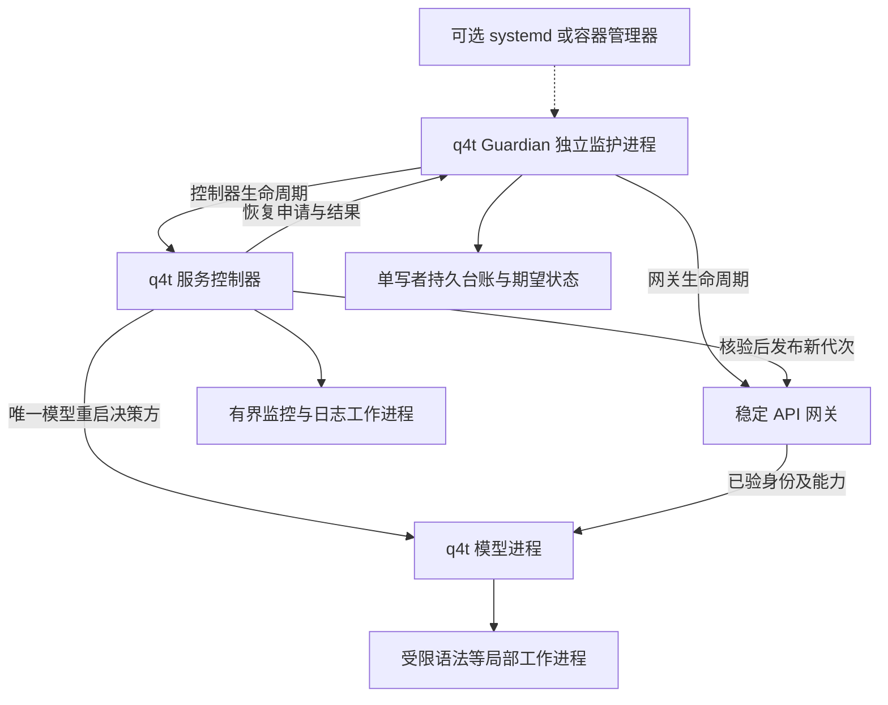

# q4t 持续服务与自动恢复设计

2026-11-07。目标是让q4t在已验部署范围内持续提供LLM服务：辅助依赖
故障只降低观察能力，局部能力故障只影响相关请求，可恢复的模型故障
自动重建进程，设备或数据完整性故障进入明确的保护状态。

本次完成设计，尚未实现或启用新的自动恢复策略。现状核对基于主线
`a6547392`；旧包继续按原合同运行。用户本次提出自动恢复要求，新的
生产策略按此方向设计，不把此前阶段的“禁止自动重启”永久沿用。
每阶段仍须完成对应验证后交付，不能只改restart开关就宣布可用。

同日补充：无systemd配置时也须具备内置监护与恢复。恢复核心由q4t
自带的独立监护进程承担，systemd仅作为可选外层，不能成为模型或
控制器自愈的前提。以下职责、预算与验收已按此要求调整。

## 服务目标与边界

- 辅助故障不得触发健康模型停止、重启或全局readiness关闭。
- 单请求失败、过载、推理无进度、进程死亡、设备故障分别决策。
- 恢复完成意味着用户入口、鉴权、配额、JSON/SSE和工具响应重新可用。
  进程存在或端口能够连接不等于恢复成功。
- 自动恢复服务，不自动重放已接收的生成请求或外部工具操作。
- 单Thor、单模型副本允许重载期间明确返回暂不可用；不承诺零中断。
  要覆盖设备/整机故障且继续生成，需要另一设备上的已验副本与路由，
  首版不自动调用外部模型或改变数据去向。
- 不自动reset GPU、卸载驱动、重启主机或修补模型文件。模型目录与
  reference目录只读。软件自愈与设备维修是不同权限边界。

## 当前能力和需要补齐的连接

| 环节 | 主线事实 | 新设计需要补齐 |
|---|---|---|
| 原生健康 | `ServiceHealth`统一GPU、PLE永久故障、内存和draining状态 | 结构化故障原因、能力可用性、独立推理进度合同 |
| NVML与辅助依赖 | v9/v10显式degrade，已通过真实模型故障注入短验 | 新生产入口默认隔离；暂停后的监控自动半开探测 |
| 后端重启 | 默认0次；旧严格包可设1..3次，仅恢复曾ready且被信号终止的后端 | 原因分类、跨控制器预算、冷却、启动失败处置；不能只看退出码 |
| 降级与重启组合 | `degrade`要求`restart_limit == 0` | 将监控策略和模型恢复策略解耦，同时保持真实设备故障保护 |
| systemd | `Restart=no`，一次性运行目录，无Install段 | 可持续的服务身份、每代次独立目录、控制器恢复与停止意图 |
| 控制器死亡 | parent-death信号促使后端退场，继承GPU锁至后端退出 | 首版完成清理再恢复；不先实现存活模型无缝接管 |
| host资源域 | 现有`Envelope`启动/清理需要systemd user manager和D-Bus | 无systemd进程模式独立可用；委派cgroup与systemd适配可选 |
| 网关 | 固定绑定controller/worker/backend身份和监听inode | 稳定用户入口、可核验的新代次绑定、恢复期间明确503 |
| 语法worker与日志 | grammar的`wait4(..., 0)`可无界等；日志错误已隔离，但写阻塞仍可堵管道 | 有界回收、占用保留、有限队列与独立写入进程 |
| 多客户端 | RPM/TPM窗口和预留在模型进程内存中 | 重启不得免费重置额度，必须携带状态或保守隔离窗口 |

代码入口：
[健康投影](../include/q4t/server/service_health.h)、
[永久故障](../include/q4t/runtime/model_health.h)、
[监督器](../tools/serve_service/supervisor.py)、
[包配置](../tools/serve_service/package.py)、
[服务入口](../tools/serve_service/service.py)、
[监控](../tools/serve_service/telemetry.py)、
[网关绑定](../tools/serve_gateway/managed.py)、
[配额](../src/server/client_policy.cpp)、
[语法进程](../src/server/grammar_process.cpp)。
已有[真实业务接受](evidence/serve-closeout-business-20261107/README.md)
证明限定故障下业务不中断，不证明新的自动重启流程已验收。

## 进程职责和唯一恢复责任方

Guardian与Controller均由q4t发布包提供，不要求用户编写循环shell
脚本。层级固定：Guardian恢复Controller与网关；Controller决定
模型故障如何处置，获得本代次授权后恢复模型。Guardian在控制器
失效时可清理旧模型树，但不绕过新Controller直接加载模型。任何
一个模型代次只有一个有效控制器，禁止各层分别重试同一启动动作。

### 内置监护进程

Guardian采用独立CPU进程，建议独立C++ host目标，不链接CUDA/NVML、
模型、媒体、语法和HTTP业务库；通过统一q4t入口启动，用户不必分别
维护多个程序。它只管理子进程身份、控制器心跳、停止意图、预算授权
和GPU租约。实际模型通过干净exec启动，不继承已初始化的GPU上下文。

监护器主循环只做有期限的IPC、pidfd事件和计时，不同步等待NVML、
模型HTTP、磁盘write/fsync或日志管道。控制记录由固定容量的事务
worker执行；Guardian是唯一逻辑写者，Controller通过带代次的申请
扣除预算，不直接写同一台账。写入超时冻结新启动，不停止健康模型。

Controller的心跳必须证明其控制循环经过一轮有效推进，不能由一个
脱离实际工作的线程无条件续命。合法加载/等待依赖期间Controller
仍响应控制通道；模型进度使用另一份阶段合同，不因正常prefill长
就判控制器死亡。旧控制器确认退出前不生成新控制器的有效授权。

模型进程中的自检线程可提供故障信号，但不能承担全部恢复职责：
模型进程整体退出后，需要仍存活的独立监护进程执行恢复。首版不
实现两个对等进程互相拉起；这会增加双主、停止复活与预算重复消费
的处理范围。最外层Guardian故障的边界见下文。

### GPU租约和后代清理

Guardian持有服务实例锁及原GPU租约，覆盖Controller/模型更换期间。
子代按需继承同一open-file-description；Controller退出只关闭自身
副本，不得调用`LOCK_UN`释放整把共享锁。子代的锁可在Guardian异常
退出后继续覆盖实际退场窗口。测试时借用严格外层guard的同一租约，
不得再独立获取一把锁。锁语义以
[Linux flock合同](https://man7.org/linux/man-pages/man2/flock.2.html)为准。

Guardian设置subreaper，用pidfd和boot/start身份识别进程，Controller
及模型保留parent-death通知并检查设置前后的父身份竞态。Controller
死亡后，Guardian收管其孤儿后代并非阻塞回收；所有已知模型/语法/
采集器后代退出且启动前检查通过，才允许新的Controller创建模型。
参考[子收割进程](https://man7.org/linux/man-pages/man2/PR_SET_CHILD_SUBREAPER.2const.html)、
[父死通知](https://man7.org/linux/man-pages/man2/PR_SET_PDEATHSIG.2const.html)
及[pidfd](https://man7.org/linux/man-pages/man2/pidfd_open.2.html)合同。
subreaper提供孤儿后代归属，不保证SIGKILL可终止内核D-state。

当前`service.py`控制器负责外层guard/租约，`backend.py`还核验既有
两级祖先关系。落地时需共同迁移到上述Guardian所有权合同；不能在
现有入口外简单再套一个拉起器，否则身份校验、父死信号和租约行为
会与设计冲突。新包必须绑定完整层级的源码及协议身份。

### 无systemd的运行方式

拟新增统一`q4t service`入口，下列子命令为设计接口，尚未实现：

| 入口 | 生命周期合同 |
|---|---|
| `run` | 默认前台运行Guardian，适合终端、容器及外部服务管理器；Ctrl-C/SIGTERM进入正常停止 |
| `start --daemon` | 显式后台化，一次创建完整服务树；启动器与Guardian握手，默认等待业务READY，不能把fork成功称为服务可用 |
| `status` | 读取Guardian实时控制状态与代次；连接失败标未知/失联，不把旧快照显示成READY |
| `stop` | 向Guardian提交持久停止意图，阻止后续恢复，再按期限清理；确认所有自有进程退出后才报告STOPPED |

后台运行建立独立会话、关闭终端输入并使用有界日志，但`setsid`不
提供开机启动，也不保证宿主会话管理器不会清理所属cgroup。后台化
只有显式请求才发生，不擅自安装crontab、rc.local、systemd单元或
其他启动脚本。当前`q4t serve`与旧包保留原含义，迁移到新入口明确
选择；后续是否将生产入口作为默认别名另行做兼容交付。
后台Guardian不对正常退出的短命启动器设置父死约束；其业务子代
仍须对各自的直接监护者设置父死通知，不能为了后台化解除整个子树保护。

控制socket与台账位于服务私有目录，校验调用者身份、请求序号和
运行代次；外部不能伪造心跳或恢复授权。并发start由服务实例锁拒绝。
stop先阻止新授权，再处理正在执行的spawn事务；若已有子进程产生，
也须纳入停止清理。后台启动就绪超时需确认停止和清理后返回失败，
不能只退出启动器、遗留一个仍会自动恢复的服务。

### 不依赖systemd的资源边界

资源接口分为三种，首版先交付process，另外两种按新所有权合同另验：

- `process`：无systemd/D-Bus依赖；使用pidfd、subreaper、进程组、
  继承锁及已有应用内存准入/申请额度。支持自有进程恢复；不宣称
  host物理内存硬上限，也不能保证宿主OOM不会杀死Guardian。
- `delegated-cgroup`：仅在操作者已提供可写且归属可核验的cgroup v2
  委派子树内管理资源，运行期直接访问cgroupfs；不需要systemd来
  创建scope，不在任意系统cgroup写入或自动提权。该适配尚未实现。
- `systemd-scope`：复用现有委派scope能力，作为可选安装配置。

用户要求硬资源边界而权限/委派不具备时，在启动前明确失败；不能
悄悄退为process模式。未要求硬边界时process模式正常可用。无
cgroup的清理仅针对已知合作子树，不把PID/进程名扫描当成安全沙箱。
Thor统一RAM计量与memcg不能覆盖全部GPU物理内存的既有边界不变。

新生产profile拟命名`service`：默认辅助降级、允许有界模型恢复；
现有严格验收入口继续用于测量，监控失效仍ENV_ABORT。生产恢复政策
从验收guard的退出决策中分离，复用已验的进程身份、锁和清理原语。
旧封存包不原地改写，新策略以新包版本显式迁移。

生产入口使用独立控制通道。TLS、独立Key和内网监听仍可按部署选择；
不启用TLS也要有稳定服务身份。首版复用已有网关能力，模型加载期间
网关可保持监听，鉴权与错误响应继续有效，不要求模型READY才启动网关。

### 可选外层与恢复上限

安装systemd时运行同一个前台Guardian，采用`Type=notify`、有界
`Restart=on-failure`、watchdog和启动频率限制；systemd只恢复Guardian，
不直接单独重启Controller/模型/网关。使用容器管理器时也以Guardian
为前台入口，并验证PID 1的信号转发/子进程回收；不在容器内暗中再
启动另一套系统服务。没有外层时，模型及Controller恢复政策完全一致。

`READY=1`表达Guardian及恢复控制通道初始化完成；业务readiness仍
单独表达模型能否接单。处于等待依赖或熔断时Guardian保持存活并
处理停止命令，不能靠退出让外层绕过应用预算。systemd watchdog
反映Guardian控制循环推进，不由NVML、日志或模型生成完成驱动；
通知socket失联不能成为Guardian自杀的理由。

实际主机为systemd 255。上述机制依照
[v255服务合同](https://github.com/systemd/systemd/blob/v255/man/systemd.service.xml)
和[启动限频合同](https://github.com/systemd/systemd/blob/v255/man/systemd.unit.xml)。
这些机制不替代q4t故障分类与恢复台账；达到systemd启动上限后不会
仅因时间过去自动重试，相关终态需可观察，不承诺systemd无限自愈。

无外层时若最外层Guardian也被杀死，业务子树走父死退场路径，不能
确认回收的残留保持未知；不由残余子进程反向复活监护器。
全部服务进程被杀、整机重启/断电后，
系统内已没有执行恢复的q4t进程；必须有外部启动入口或人工再次启动。
这是独立进程自愈的故障覆盖边界，不应包装为完全无单点或开机自启。

## 故障分类和恢复动作

以下是目标策略；“重启”均指先核验并回收自有旧进程，再启动新代次。

| 故障 | 对用户的影响与首个动作 | 自动恢复与停止边界 |
|---|---|---|
| 非法输入、客户端取消、单请求截止、RPM/TPM超额 | 仅拒绝/结束相关请求 | 不影响模型健康，不触发服务重启 |
| 队列满、一般内存压力 | 429/503与退避信息；关闭新准入，已接收任务按资源合同处理 | 内存余量达到恢复阈值并满足滞回后自动开门；繁忙不判为卡死 |
| NVML超时、采集器异常、exporter/metrics失能 | 监控UNKNOWN，业务和readiness保持 | 有界重试、监控半开；不启动或重启模型 |
| systemd/D-Bus查询失联，已有控制器仍正常 | 保留已建资源域，依据内核身份/限额监督；业务继续 | 需要管理器的新建/清理动作等待核验，不把查询失败等同模型故障 |
| 普通日志写失败或阻塞 | 记录缺口，有限缓冲满后丢弃日志 | 重建可回收的日志worker；不堵模型输出，不无界排队 |
| 可选缓存读写/校验失败 | 失效相关缓存，能从完整输入重建时走原计算路径，否则仅该请求失败 | 可恢复缓存能力；不得使用损坏状态、改变提示或伪造缓存命中 |
| 语法worker故障 | 依赖该worker的严格JSON/schema/required工具请求明确失败；普通聊天可继续 | 回收后重建局部worker；未回收仍占容量，不降为无约束输出 |
| 单个坏图片/视频、媒体处理组件故障 | 单请求失败，或仅媒体能力不可用 | 能证明核心健康时保留文本；不静默忽略媒体内容 |
| 模型进程意外退出、可归因的进程级故障 | 关闭业务准入，当前请求明确中断 | 清理与资源预检通过后有界重启；未知退出可给一次探测性恢复，不假定所有SIGKILL都安全 |
| 模型仍活着但执行无进度 | 先验证阶段、控制通道和实际完成进度 | 确认超过已验阶段期限后退场重启；正常长prefill/背压不重启 |
| CUDA上下文被错误污染 | 停止在旧进程提交工作 | 设备未损坏且完整清理后允许新进程一次恢复；同故障重现则熔断 |
| 确认GPU丢失、不可纠正设备故障、驱动持续无响应 | 关闭接单，保留故障身份 | 节点隔离，不用反复模型重载替代设备维修 |
| PLE读取暂不可达后形成永久故障 | 旧模型不清除永久故障标记 | 只读依赖探测恢复且身份正确后重建模型；数据损坏/身份不符直接锁定 |
| host OOM、任务数超限、持续临界内存 | 按现有保护退场；核对内核事件和原因 | 资源恢复稳定后才给有界启动；同配置反复OOM不得立即重载 |
| 必需的内存/有效限额/OOM事件等安全证据持续未知 | 先关闭新准入，按已验资源预算处理已接收工作 | 证据恢复则开门；无法证明资源安全则保护停服，不把未知伪造为真实OOM或空闲 |
| 控制器异常死亡 | 首版沿用父死退场，入口报告恢复中 | 内置Guardian确认旧控制器/模型树退出，恢复控制器，再按同一预算重载 |
| Guardian异常死亡 | 子树按父死规则退场，清理不能确认时保留未知 | 可选外层恢复Guardian；无外层首版需重新启动，不由子进程反向拉起 |
| 网关进程故障 | 用户入口暂不可用，模型保持 | 独立重启网关并重新核对后端代次，不重启模型 |
| 鉴权、配置、发布身份或关键安全控制证据损坏 | 拒绝受影响业务/启动 | 不降级成无鉴权或未知版本；修复配置后显式重新评估 |
| 恢复台账无法持久化 | 健康模型可继续，冻结新的自动替换动作 | 台账恢复并重新核验后继续；不按空台账获得新预算 |
| 操作者停止、维护模式 | 关闭接单并按期限退场 | 期望状态优先，不因后端退出被自动拉起 |

CUDA进程错误与设备硬故障必须细分。例如非法地址可能使当前进程
无法继续使用CUDA，需结束并重启进程；不能仅清除健康位继续计算。
这是[NVIDIA错误合同](https://docs.nvidia.com/cuda/cuda-runtime-api/cuda_runtime_api/group__CUDART__TYPES.html)
要求的进程边界，不代表重启一定能修复内核bug。落地分类表同时核对
本机构建使用的CUDA 13.3头文件，不直接采用更新版本新增错误码。

## 健康状态和进度判定

生命周期使用`STARTING / SERVING / DRAINING / RECOVERING /
WAIT_DEPENDENCY / CIRCUIT_OPEN / QUARANTINED / STOPPED`。
辅助状态与生命周期正交：例如`SERVING + nvml=UNKNOWN`仍可接单。

| 维度 | 含义 | 对接单的影响 |
|---|---|---|
| live | 控制循环/HTTP服务线程能够响应 | 不能单独证明模型正常 |
| ready | 模型完整、未退场且基础准入开放 | 不依赖日志、NVML和metrics完整性 |
| progress | 当前阶段及最近一次实际完成工作的时间/序号 | 用于区分卡死与正常忙，不能取代故障事件 |
| capabilities | text/media/strict_json/tools等所需组件可用 | 针对请求所需能力准入，不夸大能力、不静默降合同 |
| observations | 各数据源新鲜度、未知、历史缺口 | 只影响观察可信度；关键资源安全证据另行分类 |

新增本机私有、固定大小的故障/进度通道，携带`service_id`、boot ID、
controller/engine generation、事件序号、故障类别/范围、原始错误码、
证据时间和置信度。公共OpenAI响应保留现有错误结构，细节放在鉴权
运维入口。旧代次事件和过期快照不能触发当前模型的停止或恢复。

不能从日志字符串、GPU利用率、TTFT或输出token间隔单独推断卡死。
原生已经有`execution_steps_total`，后续补全加载、PLE读取、prefill
分块、decode完成、媒体预处理及输出等待的阶段进度；直接暴露精简
快照，不重新让metrics解析成为监督前置。GPU工作完成边界才递增
执行进度，提交kernel或另一个心跳线程存活不算模型有进展。

空闲没有待执行工作，不运行无意义的生成探针。请求排队与客户端
写背压有自己的期限；多请求时还要检查最老任务的阶段/等待原因，
不能让其他请求的进展永久掩盖一个卡死任务。长上下文、加载和媒体
各自使用经过短验的阶段上限；首版未校准的阶段只报告疑似卡死，
不拿统一30秒规则自动杀死模型。已确认进程死亡无需等待这些期限。

恢复后的首次对外开门前做一次有界本地生成检查，并核对所声明能力。
恢复检查不执行外部工具；严格工具能力可检查生成参数及协议，真实
工具执行仍由调用方负责。稳定服务期间不周期性制造高成本模型请求。

## 一次恢复的执行顺序

1. 原子记录故障和当前代次，检查期望状态、停止意图和已有恢复事务。
   同一代次只能有一项恢复动作，多路故障合并，严重事实不能被超时遮蔽。
2. 关闭新准入；仍能安全完成的请求按退场期限处理。上下文已失效时
   直接终止相关执行，不继续生成貌似成功的结果。
3. 请求正常退出，超时才按pidfd、归属进程树及已配置的cgroup终止
   自有后端/后代。
   清理期限到达仍有旧进程时进入QUARANTINED；不把SIGKILL已发送
   当成已退出，不释放其容量、不启动第二份模型。
4. Guardian持续持有同一GPU租约；核对进程、监听、已启用资源域、
   内存、模型与发布身份。新控制器不能凭历史PID或旧状态文件认领
   一个活进程；Guardian所有权中断后重新走冷启动核验。
5. 预先持久扣除恢复预算、创建唯一代次目录，再启动模型。任一步骤
   中断后按事务身份对账；不把崩溃前已发起的尝试当作没发生。
6. 初始化、真实进度、健康与能力检查通过后，向网关发布新代次。
   网关重新核对ELF、配置、认证策略、监听归属及代次，原子切换新
   请求的绑定；旧连接保持原代次，不能被接到新模型续写。
7. 接单前处理配额恢复窗口，最终开门；记录恢复耗时、失败请求、
   是否降级、预算余量和清理证据。稳定窗口用于结束故障事件，不抹去历史。

父进程死亡后的首版采用完整退场再启动，不做存活模型接管。若内核
D-state进程无法回收，就承认恢复被设备/内核阻塞；不增殖worker或
绕过旧锁。锁文件本身不删除，进程/FD所有权才是判断依据。

### NVML失能时的重启边界

NVML不是生产运行期的模型健康判据，也不应成为所有重启的必经门。
需要分别实现和验证三条路径：

- **模型健康且NVML失能**：继续原模型，仅恢复监控。
- **Guardian连续持有原租约，模型需重启且NVML仍未知**：只有确认全部
  自有旧GPU进程/后代退出、关键内存/资源证据有效、无已知竞争和
  设备故障，才允许一次不依赖NVML的小型CUDA初始化/运算探测；
  探测回收并通过后按预算重载。探测与模型互斥、始终持同一租约，
  卡住不再创建新探测。此路径是待实现的生产政策，不是现有能力。
- **冷启动、Guardian所有权中断或残留归属不明**：默认等待依赖/归属
  核验恢复，自动按低频探测条件；不能用“NVML没回答”推定GPU空闲。
  完全不依赖NVML的冷启动需要独占节点/设备访问控制的额外部署合同，
  不作为共享开发机首版承诺。

连续租约和/proc核验只覆盖合作会话及可识别进程，不能证明没有
不可见的外部GPU使用者。CUDA探测也不证明GPU独占或排除所有设备
故障。生产路径接受的这一可见性边界必须写入部署合同；严格验收
仍使用独立外层监控，新路径以故障注入验证，不降低性能证据要求。

## 恢复预算和持久状态

以下为首版建议参数，属于设计值，须在阶段实现前冻结并以短验校准，
不是已达到的恢复时间或长期稳定性结果。

| 对象 | 预算和退避 | 预算耗尽后 |
|---|---|---|
| NVML临时失败 | 复用5/10/20/40/60秒快速退避；随后每5分钟至多一次半开，最多一个查询worker | 健康业务继续；旧worker未回收则完全禁止新建；配置/协议错误等待修复或一次有界组件重建 |
| 局部工作进程 | 同一组件最多1个未回收实例，15分钟最多3次重建 | 仅关闭对应能力；条件恢复后单次半开，不扩大进程数 |
| 模型替换 | 全服务滚动30分钟最多3次、24小时最多6次；连续失败等待5/20/60秒并加有上限抖动 | CIRCUIT_OPEN；至少15分钟且预算自然释放后才允许一次半开 |
| 明确同类模型故障 | 两次不同模型代次重复相同发布/配置/故障指纹 | QUARANTINED，等待修复或已验配置变更，不无限消耗每日预算 |
| 控制器 | Guardian限制15分钟最多3次启动，并核对持久模型预算；无systemd同样执行 | Guardian保留状态/停止入口，达到冷却与预算条件后只做一次半开；不可恢复原因锁定 |
| Guardian | 配置外层时独立限制15分钟最多3次启动，读取同一持久预算 | 外层达到限制保留failed；无外层不承诺Guardian自身复活 |
| 退出清理 | 初始建议TERM 30秒、KILL后确认5秒 | 清理未确认则不重载，保留身份和锁占用事实 |
| 模型启动和恢复检查 | 加载300秒、一次恢复生成30秒作为首版上限候选 | 记启动失败并扣预算；特殊profile单独确定，不无限延时 |

统计按稳定`service_id`进行，不按PID、运行目录、模型代次或包版本
重新开始。成功运行10分钟且有成功请求可结束当前故障事件，但不会
清零滚动/日预算。手动恢复也记录尝试；显式修改政策不得悄悄擦掉历史。

期望状态`RUNNING / STOPPED / MAINTENANCE`、当前代次、待完成动作、
预算和最后已验包存入私有持久控制台账，先写意图再执行副作用。
boot ID和单调时间用于同次启动计时；跨boot/时钟回拨按保守预算
恢复，不能因时钟异常获得额外重启。缺失/损坏台账不能当成首次部署。

普通日志可丢，恢复授权与停止意图不能伪造成功。持久化错误时允许
健康模型继续服务，但冻结新替换；磁盘恢复后对账再继续。停止请求
仍优先结束当前服务；若停止意图不能持久化，要明确报告“跨重启
停用未确认”，不能承诺下一次开机不会重新启动。自动开机入口只在
系统服务安装时启用，并遵守持久期望状态。

控制台账写入也可能阻塞，因此必须离开主控制循环，采用单个有界
事务worker与有限队列；超时标未知，恢复后先对账，不能另起写进程
重复同一事务。普通日志的写入进程使用独立有界队列，队列满时丢弃
并累计缺口，不阻塞模型或控制器。磁盘留存按总字节/代次数双限额，
不删除活跃代次、未闭合故障或唯一回退包。

日志配额用尽而保护记录仍需保留时，停止增加诊断文件并报告容量
不足；不通过自动删除唯一故障证据腾空间。恢复台账使用独立固定
容量与有界事务记录，禁止每次轮询追加无上限历史。

## 请求和客户端合同

- 模型未可用时，稳定入口返回OpenAI兼容503和`Retry-After`，错误码
  区分`service_recovering`、`capability_unavailable`和锁定故障。
  限额仍用429；鉴权失败不能变成可重试的503。恢复期间不跨代次
  保留生成队列；正常接单的队列维持固定容量和期限。
- 已开始SSE的响应无法改写HTTP状态；还能安全写出时发送终止错误，
  进程被杀时允许明确断流。客户端将缺少合法终止帧视为失败，不拼接
  两代输出，不伪造`finish_reason`或成功`[DONE]`。
- 恢复不重放POST、不执行工具、不重放工具结果。服务只能保证恢复
  层不额外发送一次请求，不能宣称外部工具“恰好一次”；外部执行方
  需要自己的幂等键和台账。现有`proxy_next_upstream off`继续保留，
  [nginx重试合同](https://nginx.org/en/docs/http/ngx_http_proxy_module.html#proxy_next_upstream)
  也不能提供已发出响应后的透明续传。
- 取消、任务和会话引用绑定模型代次；旧取消命令不能命中新代请求。
  缓存只按已有身份合同复用；重启后的KV/前缀缓存丢失可导致性能变冷，
  不能用不匹配的缓存换取恢复速度。
- 首版保守处理进程内RPM/TPM丢失：核实旧模型完全退出后，启用分钟
  配额的客户端至少等待一个完整60秒窗口，再向新模型开放准入；
  时间和旧退出状态无法确认则保持关闭。该窗口与模型加载并行计算。
  后续可迁移独立配额台账减少等待，但不能以重启免费重置配额。

## 可选业务降级的范围

准入收缩、缓存旁路和辅助采集暂停可在当前实例内进行。关闭MTP、
改变上下文上限、禁用视觉或切换回退发布包，必须是事先验收的完整
profile，并在新代次的config/capabilities中公开，不临时拼参数。
超出降级上限的请求明确拒绝，不截断用户提示、丢弃图片或降低schema
保证。每项能力按请求实际依赖判定，不能简单把所有工具请求都关闭。

首版自动恢复保持同一模型/精度/执行profile。业务降级profile和软件
回退后续独立交付；回退最多选择一个已验包，验证身份和状态兼容。
驱动故障、NVML失能和外部压力不能自动归因为软件升级并循环回退。

## 分阶段交付与验收

| 阶段 | 有界交付内容 | 完成标准 |
|---|---|---|
| A 故障和政策合同 | Guardian/Controller职责与IPC、无systemd进程模式、新生产profile、统一事件、监控解耦及单写者持久预算 | CPU决策/虚拟时钟/事务恢复与真实CPU子树清理通过，停止优先；不宣称已恢复真实模型 |
| B 自动恢复业务闭环 | 内置Guardian、模型清理重建、NVML未知的连续租约路径、网关代次重新绑定、配额保护 | 无systemd/D-Bus下真实模型及Controller异常退出后自动恢复JSON/SSE/工具；同锁无重叠，停止不复活；可选外层另验 |
| C 局部故障和卡死 | grammar有界回收、日志及台账阻塞隔离、阶段进度监督、能力级降级 | 不可回收worker不增殖，普通聊天可用，长prefill/背压不误杀，确认卡死能按B流程恢复 |
| D 可选恢复策略 | 已验轻量profile、发布回退、独占节点冷启动及独立委派cgroup适配 | 每个profile单独限定接受；未配置不启用，不阻塞A/B/C交付 |

先完成A/B形成实际自动恢复能力，再补C的难故障；不把exporter展示、
全部客户端改造或设备自恢复当作前置。C涉及的阻塞边界在B交付时
明确列出，B不得宣称已覆盖任意卡死。旧
[后续清单](SERVE_RESILIENCE_NEXT_PLAN_2026-11-07.md)
中的grammar工作进入C；exporter按状态合同适配，观察器不能操作模型。

每阶段先冻结修改清单，成组实现后统一运行针对性CPU用例，只有具体
失败才重验受影响项。运行时交付补真实HTTP质量和工具闭环，按可靠性
业务推进验收，不混用性能优化结论。GPU验证继续经共享严格租约执行。

B首轮建议上限为4次模型启动（包括所有自动重启）、20条Chat、30分钟，
一个完整驱动持锁；在实现后冻结具体顺序。覆盖正常请求、辅助故障
保持PID、一次自有模型异常退出及自动恢复、一次控制器退出后的恢复、
网关新代次、停止清理。主验使用无systemd/D-Bus的process模式；
可选外层启动/停止与新资源适配分别验收，不从旧scope证据继承。
启动或预算条件不足就报告未验项，不扩大尝试。
NVML故障注入仅影响被验服务的采集器，外层验收监控保持严格；不制造
真实硬件损坏、宿主机OOM、磁盘写满或D-state。

CPU矩阵另外覆盖：NVML长期未知、监控worker未回收、日志返回错误与
模拟阻塞、OOM原因识别、旧代次事件、PID复用、监听冒用、同时故障、
控制器每个事务断点退出、预算跨重启/boot、时钟回拨、台账损坏、
停止与重启竞态、输入长耗时、SSE半途断流、工具不重放、配额窗口。
内置监护额外覆盖：无systemctl/busctl可执行环境、无cgroup委派、
并发start、前台Ctrl-C/后台启动握手、Controller退出与无心跳、
Guardian退出不反向复活、孤儿后代回收、共享锁副本误解锁负控。
不能用CPU注入证明真实内核阻塞可被限时终止。

记录故障检测时间、从故障到首条成功请求的恢复时间、恢复期间503与
中断请求数、误重启、重复请求/工具数、峰值进程/FD/日志空间、预算
和清理结果。首版要求零辅助故障触发的模型重启、零自动请求重放、
零重叠模型、零停止后自动复活；恢复时间由实测分解，不先宣称SLA。
长期稳定性仍由用户安排；各阶段短验可独立形成交付和回退边界。

## 参考系统提供的边界

本地vLLM参考源码`67111973eeb104e83bc6707a2d0f139737b711a0`中，
health路由检查EngineClient并在EngineDead时返回503；launcher的
watchdog发现engine错误时依据keep-alive策略退出API服务。可借鉴
“引擎故障必须传播至对外健康”，这些代码不能证明vLLM内部能修好
驱动或无限自动恢复。参考文件为
[health](../reference/vllm/vllm/entrypoints/serve/instrumentator/health.py)和
[launcher](../reference/vllm/vllm/entrypoints/launchers/launcher.py)。

q4t需把这一健康传播与自身的SSD依赖、统一RAM、GPU互斥、严格工具
输出和系统服务生命周期结合。首版重点是恢复完整业务入口，并让
无法恢复的原因可见；不再以“进程已退出”作为可靠性工作的终点。
